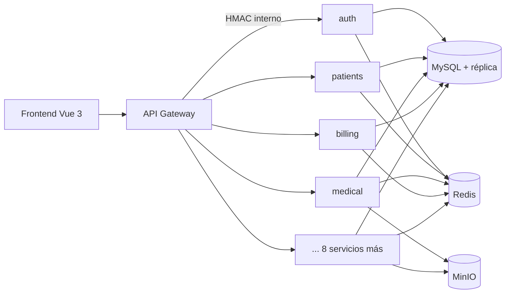

# VetManager Pro

Plataforma de gestión integral para clínicas veterinarias multi-sucursal, construida con una arquitectura de microservicios en Node.js y un frontend en Vue 3.

Cubre el circuito completo de una clínica: turnos, pacientes y propietarios, historia clínica, vacunación, laboratorio e imágenes, cirugías e internación, inventario, facturación (MercadoPago, Stripe y AFIP), telemedicina, peluquería, reportes, notificaciones multicanal y un portal de autogestión para los dueños de las mascotas.

## Funcionalidades

| Área | Qué incluye |
|---|---|
| Operación | Agenda de turnos con control de concurrencia, triage, dashboard del día |
| Clínica | Pacientes y propietarios, evoluciones médicas, diagnósticos, recetas, vacunas y desparasitaciones |
| Diagnóstico | Órdenes de laboratorio, diagnóstico por imágenes y patología |
| Internación | Cirugías, hospitalizaciones y seguimiento |
| Gestión | Inventario multi-sucursal con lotes, facturación electrónica, reportes programados y exportables |
| Servicios | Telemedicina (WebRTC), grooming, asistente de IA con circuit breaker |
| Comunicación | Bandeja interna, email, SMS, WhatsApp y push (FCM) con cola de reintentos |
| Documentos | Ingesta de documentos por correo (Gmail, IMAP, Outlook) con OCR y asociación a pacientes |
| Portal | Acceso de los dueños a turnos, historia y facturas de sus mascotas |

## Arquitectura



- **`gateway/`**: punto de entrada HTTP y WebSocket. Autenticación, WAF, rate limiting, CSRF, versionado de API y proxy hacia los servicios con firma HMAC.
- **`services/`**: 12 microservicios independientes (`auth`, `patients`, `medical`, `lab-imaging`, `billing`, `telemedicine`, `grooming`, `reports`, `notifications`, `portal`, `ai`, `documents`), cada uno con su contrato OpenAPI.
- **`shared/`**: capa de plataforma común (base de servicio, base de datos, JWT, RBAC/ABAC, cifrado de campos, auditoría, event bus con outbox, tracing, métricas, feature flags).
- **`andromeda-front/`**: SPA en Vue 3 + Vite + Pinia.

Más detalle en [docs/architecture.md](docs/architecture.md).

## Stack

| Capa | Tecnologías |
|---|---|
| Backend | Node.js 20, Express, Zod / express-validator, OpenAPI |
| Datos | MySQL 8 (primaria + réplica de lectura), Redis, MinIO (S3) |
| Frontend | Vue 3, Vite, Pinia, Vue Router, Playwright |
| Seguridad | JWT RS256 con rotación de claves, Argon2, CSRF, RBAC dinámico, 2FA, cifrado AES-256-GCM de datos sensibles |
| Observabilidad | Prometheus, Grafana, Alertmanager, Tempo (OpenTelemetry), logs estructurados con Winston |
| Infraestructura | Docker Compose, Kubernetes, Terraform, Railway |
| Calidad | Jest, Supertest, tests de contrato, mutation testing (Stryker), k6, CodeQL, Trivy |

## Seguridad

- Access y refresh token en cookies `httpOnly`, con token CSRF separado.
- JWT firmados con RS256 y soporte de rotación de claves (keyring con `kid`).
- RBAC dinámico por organización y ABAC por sucursal; aislamiento multi-tenant en cada consulta.
- Comunicación entre servicios firmada con HMAC y ventana de validez.
- Cifrado a nivel de campo para datos clínicos y personales.
- WAF, protección SSRF, rate limiting distribuido, detección de fuerza bruta y fingerprint de dispositivo.
- Auditoría de accesos y de cambios de permisos, exportable a SIEM.

Detalle capa por capa en [docs/SEGURIDAD.txt](docs/SEGURIDAD.txt).

## Puesta en marcha

Requisitos: Node.js 20, MySQL 8 y Redis 7 (o Docker).

```bash
cp .env.example .env          # completar credenciales y secretos
npm ci
npm run migrate
```

Con Docker Compose se levanta el stack completo (gateway, servicios, frontend, Redis, MinIO y observabilidad):

```bash
docker compose up -d
```

| Servicio | URL |
|---|---|
| Frontend | http://localhost:5174 |
| API Gateway | http://localhost:4050 |

Frontend en modo desarrollo:

```bash
cd andromeda-front
npm ci
npm run dev
```

## Tests

```bash
npm run test:unit         # unitarios
npm run test:security     # CORS, CSRF, rate limit, sanitización
npm run test:contract     # contratos entre gateway y servicios
npm test                  # suite completa (requiere MySQL y Redis)
```

## Documentación operativa

- [Arquitectura](docs/architecture.md)
- [Runbook](docs/runbook.md) · [Rollback](docs/rollback.md) · [Recuperación ante desastres](docs/dr-runbook.md)
- [Backups y restore](docs/backup-restore.md)
- [Ingesta de documentos](docs/documents-ingestion.md)
- [Gestión de secretos](docs/SECRETS_MANAGEMENT_BASELINE.txt) · [Retención y costos](docs/RETENTION_AND_COST_POLICY.txt)
- [Escenarios de chaos testing](docs/CHAOS_SCENARIOS_MATRIX.txt)

Los cambios se registran en el [CHANGELOG](CHANGELOG.md).
