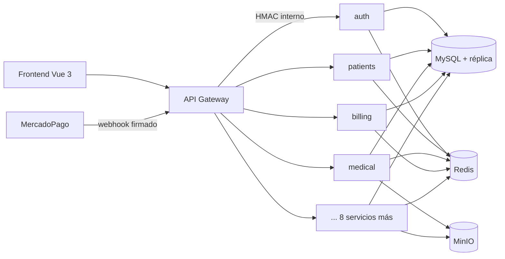

# Andromeda

[](https://github.com/ajpfox10/REP-PORTAFOLIO/actions/workflows/veterinaria-ci.yml)

Plataforma SaaS de gestión para clínicas veterinarias multi-sucursal. Backend de microservicios en Node.js y frontend en Vue 3.

Una clínica se registra sola, prueba el plan Pro gratis por 14 días y después se suscribe con MercadoPago. Desde ahí maneja todo el circuito de la clínica: turnos, pacientes y dueños, historia clínica, vacunación, laboratorio e imágenes, cirugías e internación, inventario, facturación, telemedicina, peluquería, reportes y un portal de autogestión para los dueños de las mascotas.


## Modelo SaaS

| | Free | Básico | Pro | Enterprise |
|---|---|---|---|---|
| Sucursales | 1 | 1 | 3 | Sin límite |
| Usuarios | 2 | 3 | 15 | Sin límite |
| Precio mensual (ARS) | $0 | $29.900 | $59.900 | $119.900 |

- **Registro autoservicio**: crea la organización, la sede principal y el usuario administrador, y arranca una prueba Pro de 14 días.
- **Suscripciones con MercadoPago** (Preapproval): checkout, cancelación y webhook con firma verificada y eventos deduplicados. Sin credenciales y fuera de producción funciona en modo demo.
- **Límites por plan**: al superar el cupo de sucursales o usuarios, la API responde `402 PLAN_LIMIT_REACHED` y la interfaz invita a cambiar de plan. También aplica al alta por SSO.
- **Cuotas de uso** por funcionalidad (IA, SMS, etc.) en Redis, con tope absoluto incluso en planes ilimitados.

| Landing | Suscripción y uso |
|---|---|
|  |  |

## Reportes

Centro de reportes con resumen, finanzas, atención clínica y envíos programados:

- KPIs del período, facturación por día, semana o mes, medios de pago, especies, diagnósticos y turnos.
- Cada gráfico tiene su vista de tabla accesible.
- Exportación a Excel, CSV y PDF.
- **Envíos programados**: reportes diarios, semanales o mensuales que llegan por email. El scheduler reclama cada envío de forma atómica, así varias réplicas nunca mandan el mismo reporte dos veces.


## Funcionalidades

| Área | Qué incluye |
|---|---|
| Operación | Agenda de turnos con control de concurrencia, triage, panel del día con primeros pasos |
| Clínica | Pacientes y dueños, evoluciones, diagnósticos, recetas, vacunas y desparasitaciones |
| Diagnóstico | Órdenes de laboratorio, diagnóstico por imágenes y patología |
| Internación | Cirugías, hospitalizaciones, monitoreo y alta |
| Gestión | Inventario multi-sucursal, facturación (MercadoPago, Stripe, AFIP), sucursales y equipo |
| Servicios | Telemedicina (WebRTC), peluquería con comisiones, asistente de IA con circuit breaker |
| Comunicación | Email, SMS, WhatsApp y push (FCM) con cola de reintentos |
| Documentos | Ingesta por correo (Gmail, IMAP, Outlook) con OCR y asociación a pacientes |
| Portal | Los dueños ven turnos, historia clínica, vacunas y facturas de sus mascotas |

La interfaz tiene modo claro y oscuro, búsqueda global con `Ctrl+K` y está en español (con inglés disponible).

## Arquitectura



- **`gateway/`**: punto de entrada HTTP y WebSocket. Autenticación, WAF, rate limiting, CSRF, versionado de API y proxy firmado con HMAC hacia los servicios.
- **`services/`**: 12 microservicios (`auth`, `patients`, `medical`, `lab-imaging`, `billing`, `telemedicine`, `grooming`, `reports`, `notifications`, `portal`, `ai`, `documents`), cada uno con su contrato OpenAPI.
- **`shared/`**: plataforma común (base de servicio, base de datos, JWT, RBAC/ABAC, suscripciones, cifrado de campos, auditoría, event bus con outbox, tracing, métricas).
- **`andromeda-front/`**: SPA en Vue 3 + Vite + Pinia.
- **`scripts/migrations/`**: esquema completo versionado (141 tablas, vistas y procedimientos), compatible con MySQL 8 y MariaDB.

Más detalle en [docs/architecture.md](docs/architecture.md).

## Stack

| Capa | Tecnologías |
|---|---|
| Backend | Node.js 20, Express, express-validator, OpenAPI |
| Datos | MySQL 8 (primaria + réplica de lectura), Redis, MinIO (S3) |
| Frontend | Vue 3, Vite, Pinia, Vue Router, Lucide, Playwright |
| Pagos | MercadoPago (suscripciones y cobros), Stripe, AFIP (factura electrónica) |
| Seguridad | JWT RS256 con rotación de claves, Argon2, CSRF, RBAC dinámico, 2FA, cifrado AES-256-GCM |
| Observabilidad | Prometheus, Grafana, Alertmanager, Tempo (OpenTelemetry), logs estructurados |
| Infraestructura | Docker Compose, Kubernetes, Terraform, Railway |
| Calidad | Jest, Supertest, tests de contrato, Playwright, CodeQL, GitHub Actions |

## Seguridad

- Sesiones del staff y del portal de dueños en cookies `httpOnly`: el JavaScript de la página nunca ve los tokens. CSRF con token separado.
- JWT firmados con RS256 y rotación de claves (keyring con `kid`).
- RBAC dinámico por organización y ABAC por sucursal; aislamiento multi-tenant en cada consulta.
- Comunicación entre servicios firmada con HMAC y ventana de validez.
- Webhooks de pago con verificación de firma e idempotencia.
- Cifrado a nivel de campo para datos clínicos y personales.
- WAF, protección SSRF, rate limiting distribuido, detección de fuerza bruta y fingerprint de dispositivo.
- Auditoría de accesos y de cambios de permisos, exportable a SIEM.

Detalle capa por capa en [docs/SEGURIDAD.txt](docs/SEGURIDAD.txt).

## Puesta en marcha

Requisitos: Node.js 20, MySQL 8 y Redis 7 (o Docker).

```bash
cp .env.example .env          # completar credenciales y secretos
npm ci
npm run migrate               # crea el esquema completo y los catálogos base
```

Variables principales del modelo SaaS (ver `.env.example`):

| Variable | Para qué |
|---|---|
| `MP_ACCESS_TOKEN`, `MP_WEBHOOK_SECRET` | Suscripciones con MercadoPago. Sin ellas, fuera de producción, el checkout funciona en modo demo |
| `TRIAL_DAYS` | Días de prueba gratuita (14 por defecto) |
| `PLAN_PRICE_BASIC`, `PLAN_PRICE_PRO`, `PLAN_PRICE_ENTERPRISE` | Precios mensuales |
| `REPORTS_SCHEDULER_ENABLED` | Activa los envíos programados de reportes |

Con Docker Compose se levanta el stack completo:

```bash
docker compose up -d
```

| Servicio | URL |
|---|---|
| Frontend | http://localhost:5174 |
| API Gateway | http://localhost:4050 |

Frontend en modo desarrollo:

```bash
cd andromeda-front
npm ci
npm run dev
```

## Tests

```bash
npm run test:unit         # unitarios
npm run test:security     # CORS, CSRF, rate limit, sanitización
npm run test:contract     # contratos entre gateway y servicios
npx jest tests/integration --forceExit   # integración de servicios
cd andromeda-front && npm run e2e        # end-to-end con Playwright
```

El CI ([`.github/workflows/veterinaria-ci.yml`](../.github/workflows/veterinaria-ci.yml)) corre las migraciones desde cero sobre MySQL 8, toda la suite del backend, el chequeo de tipos, el build y los e2e del frontend. CodeQL analiza el código en cada push.

## Documentación operativa

- [Arquitectura](docs/architecture.md)
- [Runbook](docs/runbook.md) · [Rollback](docs/rollback.md) · [Recuperación ante desastres](docs/dr-runbook.md)
- [Backups y restore](docs/backup-restore.md)
- [Ingesta de documentos](docs/documents-ingestion.md)
- [Gestión de secretos](docs/SECRETS_MANAGEMENT_BASELINE.txt) · [Retención y costos](docs/RETENTION_AND_COST_POLICY.txt)
- [Escenarios de chaos testing](docs/CHAOS_SCENARIOS_MATRIX.txt)

Los cambios se registran en el [CHANGELOG](CHANGELOG.md).
